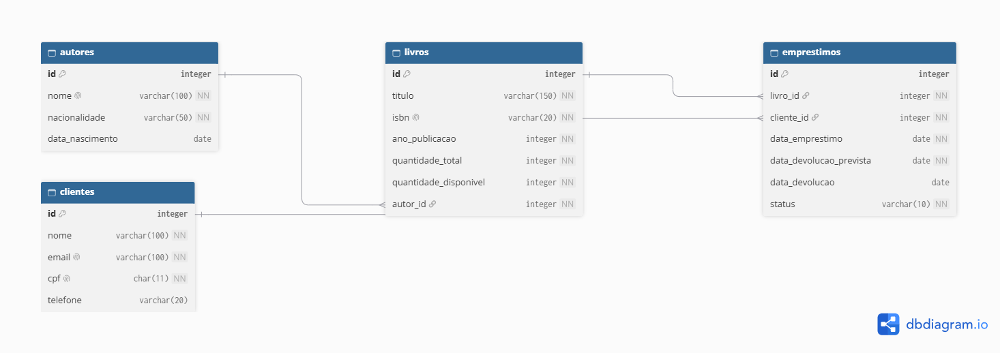

# BookStore Manager CLI

Sistema de gerenciamento de uma pequena livraria, executado pelo terminal (CLI). Permite administrar autores, livros, clientes e empréstimos, com os dados mantidos em memória durante a execução. O projeto inclui também o banco de dados relacional da livraria (DER e script SQL para PostgreSQL).

> Projeto Final Avaliativo, Módulo 01: Desenvolvedor(a) Back End Node, Turma 04.

## Objetivo

Consolidar os conhecimentos do módulo: Node.js, TypeScript, programação orientada a objetos, programação assíncrona, arquitetura em camadas, modelagem relacional e SQL, além de versionamento com Git e GitHub.

**Importante:** a aplicação **não se conecta** ao banco de dados. Os dados ficam em memória (carregados de um seed) e o banco é modelado e executado separadamente por meio do `script.sql`. Os dois usam os mesmos dados de exemplo.

## Tecnologias utilizadas

- Node.js
- TypeScript
- tsx (execução em desenvolvimento)
- PostgreSQL (banco de dados, via `script.sql`)
- Git e GitHub

## Requisitos para execução

- Node.js 18 ou superior (recomendado a versão LTS)
- npm (instalado junto com o Node.js)
- PostgreSQL 14 ou superior (somente para executar o script SQL)
- Git

## Banco de dados

### Diagrama Entidade-Relacionamento (DER)



Relacionamentos:

- Um **autor** possui muitos **livros** (1:N)
- Um **livro** pode aparecer em muitos **empréstimos** (1:N)
- Um **cliente** pode fazer muitos **empréstimos** (1:N)

### Executando o script SQL no PostgreSQL

O arquivo `database/script.sql` está dividido em três seções: DDL (criação das tabelas), DML (INSERT, UPDATE, DELETE) e relatórios (consultas).

**Pelo terminal:**

```bash
psql -U postgres -c "CREATE DATABASE bookstore;"
psql -U postgres -d bookstore -f database/script.sql
```

**Pelo pgAdmin:**

1. Crie um banco chamado `bookstore`.
2. Abra o **Query Tool** no banco criado.
3. Abra o arquivo `database/script.sql` e clique em **Executar (F5)**.

O script pode ser executado várias vezes, pois remove as tabelas antes de recriá-las.

### Relatórios disponíveis

1. Livros disponíveis
2. Livros emprestados
3. Livros cadastrados por autor
4. Quantidade de empréstimos por livro
5. Clientes com empréstimos ativos
6. Extra: total de exemplares por autor

## Instalação

```bash
git clone https://github.com/Suelenmh/bookstore-manager-cli.git
cd bookstore-manager-cli
npm install
```

## Execução

**Modo desenvolvimento:**

```bash
npm run dev
```

**Modo compilado:**

```bash
npm run build
npm start
```

## Arquitetura do projeto

A aplicação é organizada em camadas, cada uma com uma responsabilidade:

```
Usuário → Menu → Controller → Service → Repository → Dados em memória
```

| Camada | Responsabilidade |
|---|---|
| **Main** | Inicia a aplicação, carrega o seed e monta as dependências |
| **Menus** | Exibem as opções e direcionam para o controller |
| **Controllers** | Interagem com o usuário (entrada e saída no terminal) |
| **Services** | Regras de negócio e validações |
| **Repositories** | Único ponto de acesso aos dados em memória |
| **Models** | Classes, interfaces e tipos das entidades |
| **Utils** | Funções auxiliares (validações, mensagens, entrada de dados, erros) |
| **Data** | Dados iniciais (seed), iguais aos INSERTs do `script.sql` |

Os métodos de Services e Repositories são assíncronos (`async/await`), preparando o sistema para uma futura integração com banco de dados. Erros de regra de negócio usam a classe `AppError` e são tratados com `try/catch` nos menus, sem interromper a aplicação.

## Funcionalidades implementadas

- **Autores:** cadastrar, listar, consultar, atualizar e remover (não remove autor que possui livros)
- **Livros:** cadastrar, listar, consultar, atualizar e remover (exige autor existente e ISBN único; não remove livro com empréstimos)
- **Clientes:** cadastrar, listar, consultar, atualizar e remover (valida e-mail e CPF, sem duplicidade; não remove cliente com empréstimos)
- **Empréstimos:** registrar empréstimo, registrar devolução, listar todos, listar ativos e consultar por ID
- **Validações:** autor, livro, cliente ou empréstimo inexistente, livro sem disponibilidade, registros duplicados e dados inválidos

## Estrutura de pastas

```
bookstore-manager-cli/
├── src/
│   ├── main.ts
│   ├── controllers/
│   ├── services/
│   ├── repositories/
│   ├── models/
│   ├── menus/
│   ├── utils/
│   └── data/
│       └── seed.ts
├── database/
│   ├── script.sql
│   └── der.png
├── package.json
├── tsconfig.json
├── README.md
└── .gitignore
```

## Exemplos de utilização

**Menu principal**

```
==============================
  BOOKSTORE MANAGER CLI
==============================
1 - Autores
2 - Livros
3 - Clientes
4 - Empréstimos
0 - Encerrar aplicação
```

**Empréstimo de um livro sem exemplares disponíveis**

```
Empréstimos → 1 - Registrar empréstimo
ID do livro: 4
ID do cliente: 1

✖ O livro "Laços de Família" não tem exemplares disponíveis.
```

**Cadastro de autor**

```
Nome: Jorge Amado
Nacionalidade: Brasileira
Data de nascimento (AAAA-MM-DD, opcional):

✔ Autor "Jorge Amado" cadastrado com ID 5.
```

## Integrantes da equipe

- SUELEN MAIARA HEEMANN

## Kanban

[Quadro Kanban do projeto](https://github.com/users/Suelenmh/projects/1)